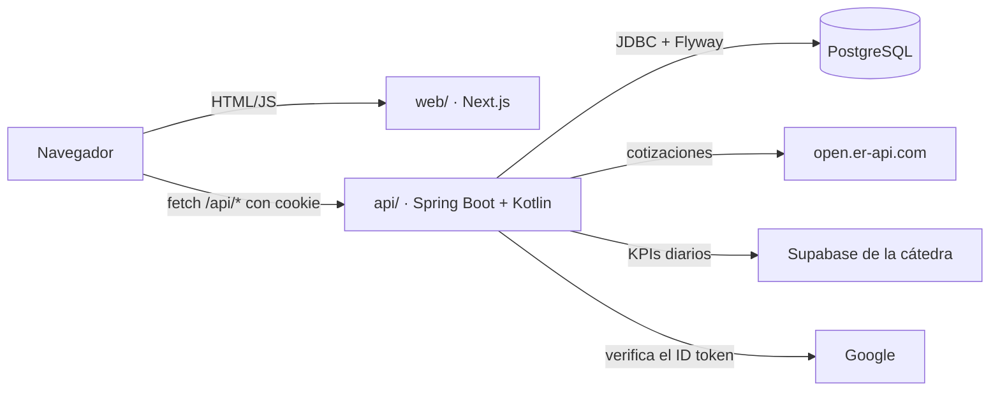
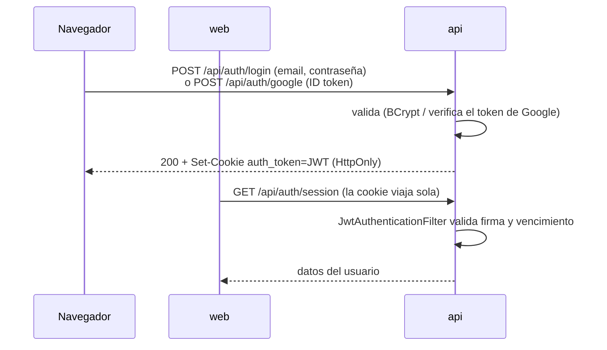
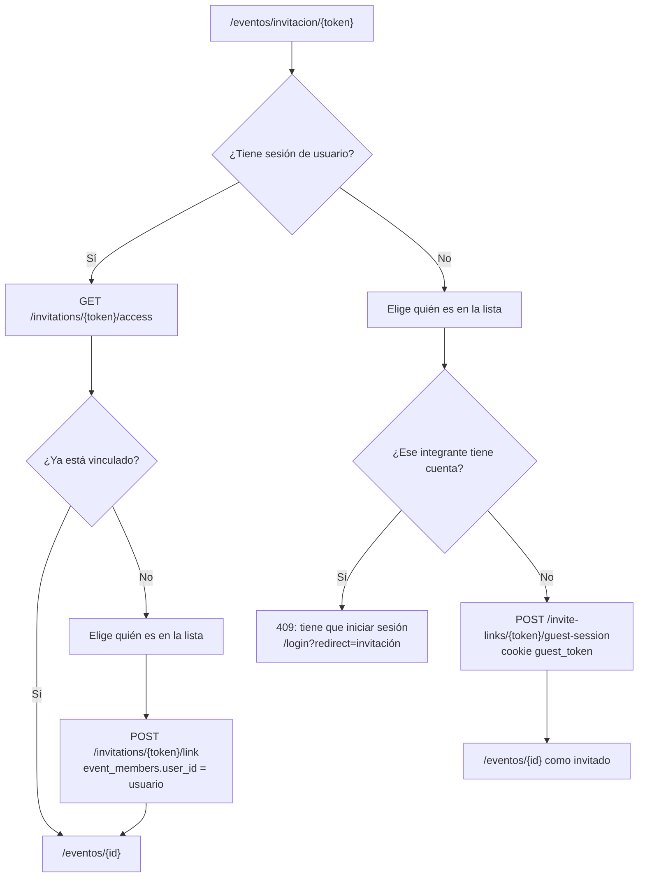
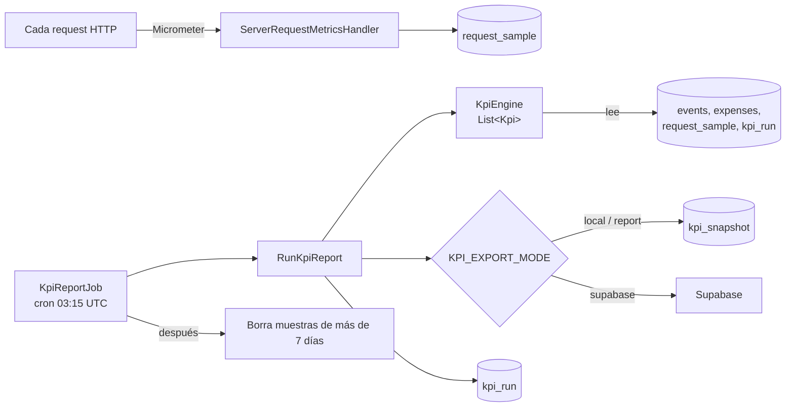
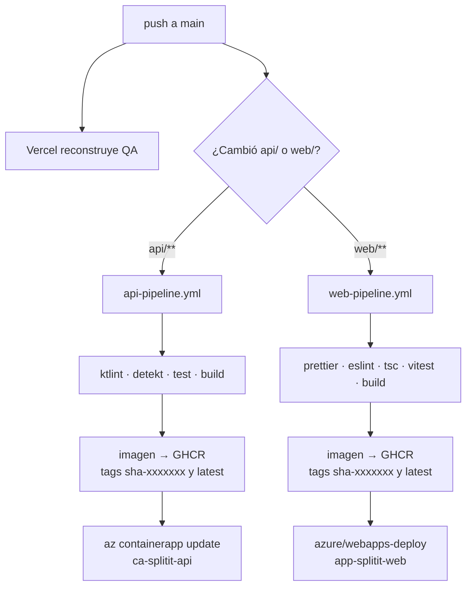

# Arquitectura de SplitIt

Este documento explica las decisiones de diseño que no se ven leyendo un archivo suelto. Para levantar el proyecto y los comandos del día a día, ver el [manual de desarrollo](DEVELOPER_MANUAL.md).

## Vista general

SplitIt es un monorepo con dos aplicaciones y una base:

- **`web/`** es solo presentación. Todas las páginas son componentes cliente que llaman a la API con `fetch` (`web/lib/api.ts`). No hay server actions ni acceso a la base desde Next.
- **`api/`** tiene todas las reglas de negocio. Sigue Onion Architecture (`domain` → `application` → `infrastructure`); las reglas están en [`api/AGENTS.md`](../api/AGENTS.md).
- **Postgres** guarda todo. El schema lo manejan las migraciones de Flyway; Hibernate solo lo valida (`ddl-auto: validate`).

Las tres capas del back:

| Capa | Qué tiene | Depende de |
| --- | --- | --- |
| `domain` | Entidades (`Event`, `EventMember`, `Expense`, `User`, `InviteLink`), value objects (`Email`, `Currency`, `EventName`) y cálculos puros (`BalanceCalculator`, `SettlementCalculator`) | Nada de Spring ni HTTP* |
| `application` | Casos de uso (`*ApplicationService`, `LoginService`, `GuestAccessService`, `RunKpiReport`…), los KPIs y los puertos (`TokenProvider`, `ExchangeRateProvider`, `KpiExporter`…) | `domain` |
| `infrastructure` | Controllers, DTOs, seguridad, repositorios JPA, clientes externos, configuración y el job de KPIs | `application` y `domain` |

\* Las entidades del dominio llevan anotaciones JPA: es la concesión que hizo el proyecto para no duplicar modelos.

## Sesión

No hay proveedor de identidad externo ni sesión en el servidor: la API emite un JWT y lo guarda en una cookie `HttpOnly`. Hay dos credenciales distintas, una para usuarios con cuenta y otra para invitados.

### Usuario con cuenta

- **Emisión.** `AuthController` (registro, login, Google) llama a `TokenProvider.issue`. `JwtTokenProvider` firma con HMAC-SHA256 usando `JWT_SECRET` (mínimo 32 caracteres: si no, la API no arranca). El token vence a las `JWT_EXPIRATION_HOURS` horas y lleva el id del usuario, su email y su nombre.
- **Cookie.** `SessionCookieWriter` la escribe `HttpOnly`, con `Secure` y `SameSite` configurables (`AUTH_COOKIE_SECURE`, `AUTH_COOKIE_SAME_SITE`) y el mismo vencimiento que el token. El front nunca lee el token: solo manda `credentials: "include"`.
- **Validación.** `JwtAuthenticationFilter` corre en cada request. Busca el token en la cookie y, si no está, en `Authorization: Bearer` (lo usan los archivos `.http`). Si es válido, el request queda con rol `USER`. La sesión de Spring es `STATELESS`: no se guarda nada en el servidor.
- **Logout.** `POST /api/auth/logout` borra las cookies. El JWT en sí sigue siendo válido hasta que vence; no hay lista de revocación.
- **Google.** El front obtiene un ID token con Google Identity Services y lo manda a `/api/auth/google`. La API lo verifica contra `GOOGLE_CLIENT_ID` (`GoogleIdTokenVerifier`). Si ya existe una cuenta con contraseña y el mismo email, la API responde 409 y el front pregunta si vincularla o reemplazarla (`GoogleLoginService`). Sin client ID configurado (QA y previews) el botón no aparece y la API rechaza el login con Google.
- **Front.** `useSession` (`web/lib/use-session.ts`) pregunta `GET /api/auth/session` y devuelve `authenticated`, `guest` o `unauthenticated`. `PrivateRoute` envuelve las páginas de `app/(private)/` y redirige a `/login` si no hay sesión.

### Credencial de invitado

Un invitado es alguien que entra a un evento por link sin crear cuenta. No es un usuario: es un integrante del evento (`event_members` sin `user_id`).

- `POST /api/invite-links/{token}/guest-session` con el `memberId` elegido. `GuestAccessService` comprueba que el link exista, que el integrante sea de ese evento y que no tenga cuenta.
- La API emite otro JWT, con el id del integrante y del evento, y lo guarda en la cookie `guest_token` por 7 días.
- Ese JWT se firma con **otra clave**, derivada de `JWT_SECRET` con HMAC. Así un token de invitado nunca valida como token de usuario, ni al revés.
- El filtro le da rol `GUEST`. `SecurityConfig` le abre solo lo que hace falta dentro de un evento: ver el evento, los gastos, los saldos y los pagos sugeridos, cotizar y cargar un gasto. Todo lo demás exige `USER`.
- `EventAccessService` además limita al invitado al evento de su credencial.
- **La credencial se revoca sola.** En cada request se vuelve a consultar el integrante (`GuestAccessService.isActive`). Si alguien vinculó una cuenta a ese integrante, la credencial deja de valer.
- Si llegan las dos cookies, gana la de usuario. Al iniciar sesión se borra la de invitado.

## Acceso al evento por link

Cada evento tiene a lo sumo un link de invitación (`invite_links`, token único). Lo pide el dueño del evento con `POST /api/events/{id}/invite-link`: la primera vez se crea y después devuelve el mismo. La URL que se comparte es `/eventos/invitacion/{token}`.

La página de invitación (`web/app/eventos/invitacion/[token]`, `EventInvitationView`) usa dos endpoints públicos: `GET /api/invitations/{token}` (nombre, ícono y cantidad de integrantes) y `GET /api/invitations/{token}/members` (quiénes son y si ya tienen cuenta). La vista previa del link (Open Graph) sale de `app/opengraph-image.tsx` y necesita `NEXT_PUBLIC_SITE_URL`.

**Con cuenta.** Vincular es permanente: el integrante pasa a ser de ese usuario y el evento aparece en su lista. Una cuenta se vincula a un solo integrante por evento (restricción única `event_id, user_id`). Si dos personas eligen al mismo integrante a la vez, la segunda recibe 409.

**Sin cuenta.** El invitado ve solo ese evento. `PrivateRoute` lo devuelve a `/eventos/{id}` si intenta ir a otra página. El navegador guarda en `localStorage` qué integrante eligió y de qué invitación vino, para preseleccionarlo y para mandarlo de vuelta a la invitación si pierde el acceso.

## KPIs

Las decisiones están en los ADR; acá va el recorrido completo:

- [Motor de cálculo (SPT-77)](adr/SPT-77-motor-de-calculo-de-kpis.md)
- [Envío y corrida diaria (SPT-78)](adr/SPT-78-envio-y-corrida-diaria-de-kpis.md)
- [Envío a Supabase (SPT-85)](adr/SPT-85-envio-de-kpis-a-supabase.md)

1. **Muestras.** Micrometer observa cada request. `ServerRequestMetricsHandler` guarda método y ruta, status y duración en `request_sample`. De ahí salen las latencias p95 y la tasa de 5xx.
2. **Disparo.** `KpiReportJob` corre con `@Scheduled` a las 03:15 UTC (`KPI_REPORT_CRON`, `KPI_REPORT_ZONE`). No hay endpoint para dispararlo. `GET /api/kpi-runs` solo lista las corridas guardadas.
3. **Ventana.** `RunKpiReport` calcula el día anterior en hora de Buenos Aires. A las 03:15 UTC son las 00:15 en Argentina: el día recién cerró.
4. **Cálculo.** `KpiEngine` recibe todos los beans que implementan `Kpi` y los calcula uno por uno. Si uno falla, su valor queda en `null` y los demás siguen. Agregar un KPI es agregar una clase en `application/kpi/` con `@Component`. Hoy son 10: los 7 del ADR más `eventos-con-gasto-en-2-min-pct`, `eventos-compartidos-pct` y `latencia-p95-saldos` (ids en `domain/kpi/KpiIds.kt`).
5. **Envío.** `KpiExportConfig` arma un solo `KpiExporter` según `KPI_EXPORT_MODE`: `local` o `report` escriben en `kpi_snapshot`; `supabase` manda las mediciones a la plataforma de la cátedra. Sin claves de Supabase el envío se saltea con un `WARN` y el cálculo sigue.
6. **Registro.** El envío y la fila de `kpi_run` (`sent`, `failed` o `skipped`) se graban en la misma transacción. El KPI `last-successful-run` sale de esa tabla.
7. **Limpieza.** Al final, el job borra las muestras de más de 7 días, aunque el envío haya fallado.

## Despliegue

Hay tres ambientes y salen de dos lugares distintos:

| Ambiente | Dónde | Cómo se actualiza | Base |
| --- | --- | --- | --- |
| Producción | Azure: Container App `ca-splitit-api` y App Service `app-splitit-web` | GitHub Actions, en cada push a `main` | La que configuran las variables de la Container App |
| QA | Vercel, deployment de `main` | Integración Git de Vercel, en cada push a `main` | Neon |
| Previews | Vercel, un deployment por PR | Integración Git de Vercel, en cada push a una rama con PR | Neon |

### Vercel (QA y previews)

`vercel.json` define un proyecto con dos servicios: `frontend` (Next.js desde `web/`) y `backend` (contenedor desde `api/Dockerfile.vercel`). Las rewrites mandan `/api/*` al backend y el resto al front. Front y API quedan en el **mismo origen**, así que la cookie es de primera parte y `NEXT_PUBLIC_API_URL` va vacío.

`Dockerfile.vercel` arranca Spring con inicialización lazy (`SPRING_LAZY_INIT`, `JPA_BOOTSTRAP_MODE=lazy`) para entrar en el tiempo de arranque de Vercel. En QA se muestra el widget de Ybug (`NEXT_PUBLIC_YBUG_ID`) para reportar bugs. Las imágenes viejas del registry de Vercel se borran con `scripts/prune-vercel-images.sh`.

### Azure (producción)

En producción el front y la API son dos servicios separados, cada uno con su imagen Docker (`api/Dockerfile`, `web/Dockerfile`). El front se construye con la URL absoluta de la API en `NEXT_PUBLIC_API_URL`.

### Qué pasa en cada push a `main`

- Cada pipeline corre solo si cambió su carpeta (o su propio workflow). Un cambio solo en `web/` no redespliega la API.
- El job `deploy` corre en el environment `production` de GitHub y entra a Azure por OIDC (`AZURE_CLIENT_ID`, `AZURE_TENANT_ID`, `AZURE_SUBSCRIPTION_ID`), sin contraseñas guardadas.
- **Solo cambia la imagen.** Las variables y secretos de producción viven en Azure y el deploy no los toca. Una variable nueva hay que cargarla a mano en Azure antes de mergear.
- Las migraciones de Flyway corren al arrancar la API nueva. Una migración rota deja la revisión nueva sin arrancar.
- En las PR los pipelines corren los checks y construyen la imagen, pero no la publican ni despliegan.

Cómo volver a una versión anterior: ver la sección *Despliegue a producción* del [README](../README.md#despliegue-a-producción-azure).
