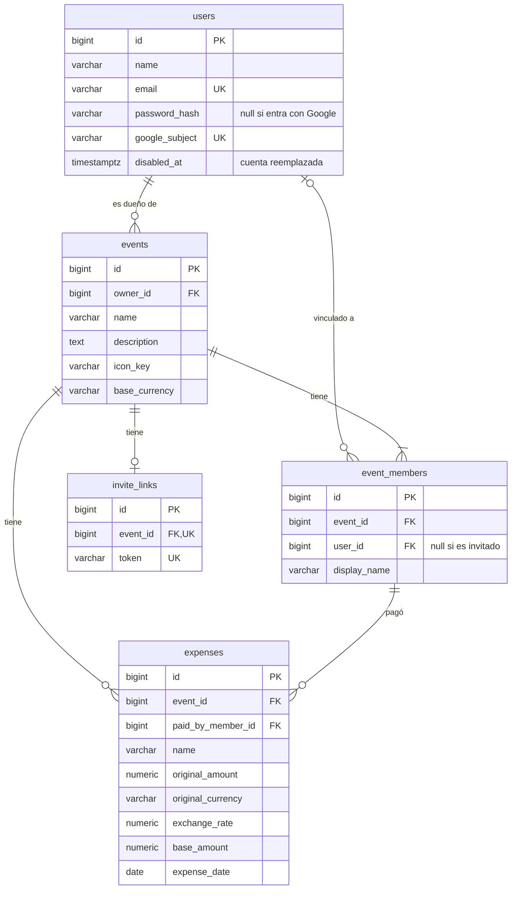

# Manual de desarrollo

Cómo levantar SplitIt en tu máquina, cómo está organizado el código y qué comandos usar. Las decisiones de diseño (sesión, invitados, KPIs, despliegue) están en [ARCHITECTURE.md](ARCHITECTURE.md).

## Requisitos previos

| Para | Necesitás |
| --- | --- |
| Levantar todo con Docker | [Docker](https://docs.docker.com/get-docker/) con Docker Compose v2 |
| Correr la API fuera de Docker | JDK 21. Gradle no hace falta: se usa `./gradlew` |
| Correr el front fuera de Docker | Node 22 y npm |
| Generar un secreto | `openssl` (o cualquier generador de texto aleatorio) |

## Levantar todo en local

Desde la raíz del repo:

```bash
cp .env.example .env
```

Completá en `.env` lo que viene vacío y es obligatorio:

| Variable | Qué poner |
| --- | --- |
| `POSTGRES_USER` | Cualquier usuario, por ejemplo `splitit` |
| `POSTGRES_PASSWORD` | Cualquier contraseña local |
| `JWT_SECRET` | Al menos 32 caracteres. Por ejemplo, la salida de `openssl rand -base64 48` |

El resto puede quedar como viene. Después:

```bash
docker compose up --build
```

La primera vez tarda unos minutos (descarga dependencias de Gradle y npm). Cuando termina:

| Servicio | URL |
| --- | --- |
| Front | http://localhost:3000 |
| API | http://localhost:8080 (`GET /api/status` devuelve `OK`) |
| Postgres | `localhost:5432`, base `splitit` |

Flyway crea las tablas al arrancar la API. No hay datos de ejemplo: registrate desde `/register` y creá un evento.

Por último, instalá los git hooks (git no versiona `.git/hooks`):

```bash
./hooks/install.sh
```

El hook de pre-commit corre formato, lint y typecheck del front, y ktlint, detekt y compilación de la API. Si encuentra formato mal, lo corrige y corta el commit: revisá los cambios, agregalos y volvé a commitear.

### Correr API o front fuera de Docker

Útil para tener recarga en caliente o depurar. Postgres sí tiene que estar corriendo:

```bash
docker compose up db
```

**API.** Lee el `.env` de la raíz sola (`spring.config.import`). Dejá `POSTGRES_HOST=localhost` y en `POSTGRES_PORT` el puerto publicado en tu máquina.

```bash
cd api
./gradlew bootRun
```

**Front.** `next.config.ts` también carga el `.env` de la raíz.

```bash
cd web
npm ci
npm run dev
```

`POSTGRES_PORT` es el puerto **en tu máquina**. Adentro del contenedor Postgres siempre escucha en `5432`, y Compose le pasa `POSTGRES_HOST=db` y `POSTGRES_PORT=5432` al servicio `api`. Si `5432` ya está ocupado, poné por ejemplo `5433`.

### Problemas comunes

- **La API no arranca y dice `JWT_SECRET must be at least 32 characters`.** El secreto es corto o está vacío.
- **Login exitoso pero la sesión no queda.** En HTTP local, `AUTH_COOKIE_SECURE` tiene que ser `false`; si no, el navegador descarta la cookie.
- **El front no llega a la API (CORS).** El origen del front tiene que estar en `CORS_ALLOWED_ORIGINS`.
- **No aparece el botón de Google.** Es lo esperado sin `NEXT_PUBLIC_GOOGLE_CLIENT_ID`. Para probarlo hace falta un client ID de OAuth de Google con `http://localhost:3000` como origen autorizado.
- **Quiero empezar con la base vacía.** `docker compose down -v` borra el volumen `db_data`.

## Variables de entorno

Todas viven en el `.env` de la raíz, que no se versiona. `.env.example` tiene las que se usan en local. Nunca subas valores reales: producción los tiene en Azure y QA en Vercel.

### Base de datos

| Variable | Default | Para qué |
| --- | --- | --- |
| `POSTGRES_USER`, `POSTGRES_PASSWORD` | — | Credenciales. Compose las usa también para crear la base |
| `POSTGRES_DB` | `splitit` | Nombre de la base. `POSTGRES_DATABASE` sirve de alternativa |
| `POSTGRES_HOST` | `db` en Docker | Host de Postgres. `localhost` si la API corre fuera de Docker |
| `POSTGRES_PORT` | `5432` | Puerto publicado en tu máquina (ver arriba) |
| `POSTGRES_SSLMODE` | `disable` | `require` contra Neon |
| `HIKARI_MAX_POOL_SIZE` | `10` | Conexiones máximas del pool |
| `JPA_DDL_AUTO` | `validate` | No cambiar: el schema lo maneja Flyway |
| `FLYWAY_BASELINE_ON_MIGRATE` | `false` | Solo para adoptar una base que ya tenía tablas antes de Flyway |

### Sesión y autenticación

| Variable | Default | Para qué |
| --- | --- | --- |
| `JWT_SECRET` | — | Firma los JWT de usuario y de invitado. Mínimo 32 caracteres |
| `JWT_EXPIRATION_HOURS` | `8` | Duración de la sesión de usuario |
| `AUTH_COOKIE_NAME` | `auth_token` | Nombre de la cookie de sesión |
| `AUTH_COOKIE_SECURE` | `true` | Cookie solo por HTTPS. `false` en local |
| `AUTH_COOKIE_SAME_SITE` | `Lax` | Atributo `SameSite` de la cookie |
| `GOOGLE_CLIENT_ID` | `NEXT_PUBLIC_GOOGLE_CLIENT_ID` | Client ID que la API exige en el token de Google. Sin ninguno de los dos, la API rechaza Google |
| `CORS_ALLOWED_ORIGINS` | localhost:3000 y `*.vercel.app` | Orígenes que pueden llamar a la API con cookie |

### API: otros

| Variable | Default | Para qué |
| --- | --- | --- |
| `SERVER_PORT` / `PORT` | `8080` | Puerto de la API. `PORT` gana (lo usa Vercel) |
| `API_DOCS_ENABLED` | `false` | `true` publica Swagger en `/api/docs`. Nunca en producción |
| `EXCHANGE_RATE_URL` | open.er-api.com | Fuente de cotizaciones para gastos en otra moneda |
| `EXCHANGE_RATE_TIMEOUT` | `5s` | Timeout del pedido de cotización |
| `EXCHANGE_RATE_CACHE_TTL` | `30m` | Cuánto se reusa una cotización |
| `SPRING_LAZY_INIT`, `JPA_BOOTSTRAP_MODE` | `false`, `default` | Arranque lazy. Los fija `Dockerfile.vercel`; en local no se tocan |

### KPIs

Detalle en el [ADR de SPT-85](adr/SPT-85-envio-de-kpis-a-supabase.md).

| Variable | Default | Para qué |
| --- | --- | --- |
| `KPI_EXPORT_MODE` | `local` | `local`, `report` o `supabase`: a dónde va la corrida diaria |
| `KPI_EXPORT_ENV` | `dev` | `dev`, `qa` o `prod`. Tiene que coincidir con la project key |
| `SUPABASE_URL`, `SUPABASE_PUBLISHABLE_KEY`, `SUPABASE_PROJECT_KEY` | — | Credenciales de la plataforma de la cátedra. Sin ellas el envío se saltea |
| `KPI_REPORT_CRON`, `KPI_REPORT_ZONE` | `0 15 3 * * *`, `UTC` | Cuándo corre el job |

### Front

Las `NEXT_PUBLIC_*` se fijan **al construir**: en Docker y en el pipeline se pasan como build args. Cambiarlas exige reconstruir la imagen. Todo lo que empieza con `NEXT_PUBLIC_` es público: no pongas secretos.

| Variable | Para qué |
| --- | --- |
| `NEXT_PUBLIC_API_URL` | URL de la API. En local `http://localhost:8080`; vacío en Vercel (mismo origen vía `/api`) |
| `NEXT_PUBLIC_GOOGLE_CLIENT_ID` | Client ID de Google. Vacío: no hay botón de Google |
| `NEXT_PUBLIC_SITE_URL` | URL pública del sitio, para las imágenes de la vista previa del link |
| `NEXT_PUBLIC_YBUG_ID` | Activa el widget de Ybug. Solo en QA |
| `NEXT_PUBLIC_MOCK_AUTH` | `true` simula login y perfil en `localStorage`, sin API. Solo para maquetar |
| `WEB_PORT` | Puerto del front en Docker Compose |

## Comandos útiles

### API (`api/`)

| Comando | Qué hace |
| --- | --- |
| `./gradlew bootRun` | Levanta la API |
| `./gradlew test` | Tests (JUnit + H2 en memoria, sin Flyway; no necesitan Postgres) |
| `./gradlew test --tests '*LoginServiceTest'` | Un test o clase |
| `./gradlew ktlintCheck` / `ktlintFormat` | Verifica / corrige el formato |
| `./gradlew detekt` | Análisis estático |
| `./gradlew build -x test` | Compila y arma el jar |

Los endpoints también se prueban con los archivos `.http` de `api/http/` (cliente HTTP de IntelliJ, ambiente `local` en `http-client.env.json`). Con `API_DOCS_ENABLED=true`, Swagger queda en http://localhost:8080/api/docs.

### Front (`web/`)

| Comando | Qué hace |
| --- | --- |
| `npm run dev` | Servidor de desarrollo |
| `npm run test` | Tests con Vitest y Testing Library |
| `npm run lint` / `lint:fix` | ESLint (sin warnings permitidos) |
| `npm run format:check` / `format` | Prettier |
| `npx next typegen && npx tsc --noEmit` | Typecheck, igual que en CI |
| `npm run build` | Build de producción |

### Migraciones

El schema lo maneja Flyway. Las migraciones están en `api/src/main/resources/db/migration/` y corren solas al arrancar la API, en local y en cada ambiente.

Para cambiar el schema:

1. Creá `V<n>__<descripcion>.sql` con el número siguiente (hoy la última es `V4`).
2. Actualizá la entidad JPA. Hibernate valida que coincidan, y si no la API no arranca.
3. Levantá la API contra tu base local para aplicarla.

Nunca edites una migración ya mergeada: Flyway guarda su checksum y los ambientes que ya la corrieron fallan al arrancar.

## Estructura del repo

```text
SplitIt/
├── api/                  Spring Boot + Kotlin
│   ├── http/             pruebas HTTP de endpoints (.http)
│   ├── Dockerfile        imagen de producción (Azure)
│   └── Dockerfile.vercel imagen de QA y previews
├── web/                  Next.js
├── docs/                 esta documentación y los ADR (docs/adr/)
├── hooks/                git hooks (pre-commit) e instalador
├── scripts/              mantenimiento (limpieza de imágenes en Vercel)
├── .github/workflows/    CI/CD
├── docker-compose.yml    entorno local
├── vercel.json           QA y previews en Vercel
└── .env.example
```

Cada app tiene su `AGENTS.md` con las convenciones a seguir: [`api/AGENTS.md`](../api/AGENTS.md) y [`web/AGENTS.md`](../web/AGENTS.md). El [`AGENTS.md`](../AGENTS.md) de la raíz tiene las reglas generales.

### API

Código en `api/src/main/kotlin/edu/austral/splitit/server/`, en tres capas (ver [ARCHITECTURE.md](ARCHITECTURE.md#vista-general)):

| Paquete | Qué hay |
| --- | --- |
| `domain/model/event`, `domain/model/user` | Entidades y value objects |
| `domain/service` | Reglas de dominio: `BalanceCalculator` (saldos), `SettlementCalculator` (pagos sugeridos), `EventTransferService`, y servicios de acceso a cada agregado |
| `domain/kpi` | Contrato de los KPIs (`Kpi`, `KpiResult`, `KpiIds`) |
| `application/service` | Casos de uso: eventos, gastos, saldos, invitaciones, login, invitados, KPIs |
| `application/kpi` | Un archivo por KPI |
| `application/port` | Interfaces hacia afuera: tokens, cotizaciones, Google, exportador de KPIs, métricas |
| `application/exception` | Errores de aplicación; `GlobalExceptionHandler` los traduce a HTTP |
| `infrastructure/api` | Controllers y DTOs, agrupados por recurso (`auth`, `event`, `invitation`, `me`, `kpi`) |
| `infrastructure/security` | JWT, cookies, filtro de autenticación, verificación de Google |
| `infrastructure/persistence` | Repositorios Spring Data y consultas de KPIs |
| `infrastructure/kpi` | Job diario, exportadores, captura de métricas |
| `infrastructure/config` | Seguridad, CORS, scheduling, clientes externos |

Los tests están en `api/src/test/kotlin/` con la misma estructura de paquetes.

### Front

| Carpeta | Qué hay |
| --- | --- |
| `app/` | Rutas del App Router. `login/`, `register/` y `eventos/invitacion/[token]/` son públicas |
| `app/(private)/` | Rutas con sesión (`dashboard`, `eventos`, `eventos/[id]`, `perfil`), envueltas en `PrivateRoute` |
| `components/` | Componentes de pantalla (vistas de evento, diálogos, header) |
| `components/ui/` | Primitivas de shadcn/ui. Se agregan con el CLI de shadcn |
| `lib/` | Un módulo por recurso de la API (`events.ts`, `expenses.ts`, `invitations.ts`…) sobre `api.ts`, que hace el `fetch` con cookie y normaliza errores. `use-session.ts` da el estado de sesión |
| `tests/` | Tests de Vitest |

Una llamada nueva a la API va en el módulo de `lib/` de su recurso, usando `request` de `lib/api.ts`. Los componentes no llaman a `fetch` directo.

## Modelo de datos



Lo que no se ve en el diagrama:

- **Integrante, no usuario.** Los gastos y saldos son de `event_members`. Un integrante puede no tener cuenta (`user_id` null): así se cargan personas que nunca se registraron, y así entran los invitados. Un usuario es integrante de un evento como máximo una vez (`event_id, user_id` único).
- **Montos.** Cada gasto guarda el monto y la moneda originales, la cotización usada y el monto convertido a la moneda del evento (`base_amount`). Los saldos usan `base_amount`, así que un cambio posterior de la cotización no mueve gastos ya cargados.
- **Saldos.** No se guardan: se calculan en cada pedido. El total de gastos se divide en partes iguales entre todos los integrantes.
- **Cuentas reemplazadas.** Cuando alguien reemplaza su cuenta con contraseña por una de Google, la vieja queda con `disabled_at` y sus eventos pasan a la nueva.
- **Fechas.** Todos los timestamps tienen zona (`TIMESTAMP WITH TIME ZONE`).

Tablas de KPIs (sin relación con las de negocio):

| Tabla | Qué guarda |
| --- | --- |
| `request_sample` | Una fila por request HTTP: ruta, status, duración. Se borra a los 7 días |
| `kpi_run` | Una fila por corrida del job: día, hora y estado (`sent`, `failed`, `skipped`) |
| `kpi_snapshot`, `kpi_snapshot_value` | Valores calculados en los modos `local` y `report` |

## CI/CD

Los workflows están en `.github/workflows/`. Qué se despliega y dónde está en [ARCHITECTURE.md](ARCHITECTURE.md#despliegue).

| Workflow | Cuándo corre | Qué hace |
| --- | --- | --- |
| `api-pipeline.yml` | PR o push a `main` que toca `api/**` | ktlint, detekt, tests y build. Después construye la imagen; en `main` la publica en GHCR y la despliega en Azure |
| `web-pipeline.yml` | PR o push a `main` que toca `web/**` | Prettier, ESLint, typecheck, Vitest y build. Después lo mismo que la API, contra el App Service |
| `qa-auto-pr.yml` | Push a una rama `claude/**` | Abre el PR que deja el agente de QA (ver [`AGENTS.md`](../AGENTS.md)) |

Además, Vercel construye QA en cada push a `main` y un preview por PR con su integración de Git, sin workflow propio.

Antes de abrir un PR conviene correr lo mismo que CI: `./gradlew ktlintCheck detekt test` en `api/`, y `npm run format:check && npm run lint && npx tsc --noEmit && npm run test` en `web/`. El hook de pre-commit cubre parte de eso.

Variables y secretos de GitHub que usan los pipelines (los valores están en el repo de GitHub, no acá):

| Nombre | Tipo | Para qué |
| --- | --- | --- |
| `AZURE_CLIENT_ID`, `AZURE_TENANT_ID`, `AZURE_SUBSCRIPTION_ID` | Secret | Login a Azure por OIDC |
| `AZURE_RESOURCE_GROUP` | Variable | Grupo de recursos de la Container App |
| `NEXT_PUBLIC_API_URL`, `NEXT_PUBLIC_GOOGLE_CLIENT_ID`, `NEXT_PUBLIC_SITE_URL` | Variable | Build args de la imagen del front. Sin `NEXT_PUBLIC_SITE_URL` el build falla |
