# Manual de usuario de SplitIt

Esta guía explica, paso a paso, todo lo que se puede hacer en SplitIt. Las capturas son de la app desde un celular, con datos de ejemplo: un asado entre amigos.

## Contenido

1. [Qué es SplitIt](#qué-es-splitit)
2. [Crear una cuenta](#crear-una-cuenta)
3. [Iniciar sesión](#iniciar-sesión)
4. [Cerrar sesión](#cerrar-sesión)
5. [Ver y editar mi cuenta](#ver-y-editar-mi-cuenta)
6. [Crear un evento](#crear-un-evento)
7. [Editar un evento](#editar-un-evento)
8. [Eliminar un evento](#eliminar-un-evento)
9. [Invitar a otros con el link](#invitar-a-otros-con-el-link)
10. [Entrar a un evento con cuenta](#entrar-a-un-evento-con-cuenta)
11. [Entrar a un evento sin cuenta](#entrar-a-un-evento-sin-cuenta)
12. [Cargar un gasto](#cargar-un-gasto)
13. [Cargar un gasto en otra moneda](#cargar-un-gasto-en-otra-moneda)
14. [Editar un gasto](#editar-un-gasto)
15. [Eliminar un gasto](#eliminar-un-gasto)
16. [Ver los saldos y los pagos sugeridos](#ver-los-saldos-y-los-pagos-sugeridos)
17. [Preguntas frecuentes](#preguntas-frecuentes)

## Qué es SplitIt

SplitIt sirve para dividir los gastos de un grupo sin hacer cuentas. Creás un evento (un asado, un viaje, una salida), anotás quiénes participan y cada uno carga lo que pagó. La app reparte el total en partes iguales, te muestra cuánto debe o recibe cada uno y te sugiere quién le tiene que pagar a quién, con la menor cantidad de pagos posible. Para sumar a tus amigos solo les mandás un link: pueden entrar y cargar gastos sin crearse una cuenta ni bajar nada. SplitIt se usa desde el navegador del celular o de la computadora, en [splitit.com.ar](https://splitit.com.ar).

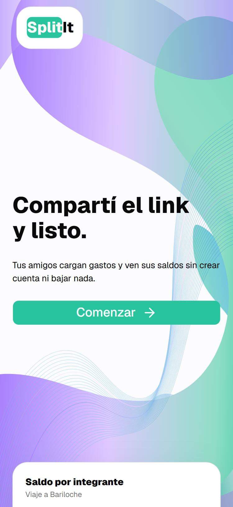

## Crear una cuenta

1. Entrá a [splitit.com.ar](https://splitit.com.ar) y tocá **Comenzar**.
2. Completá tu **nombre completo**, tu **email** y una **contraseña** de al menos 8 caracteres.
3. Tocá **Crear cuenta**. Entrás directo a tu lista de eventos.

   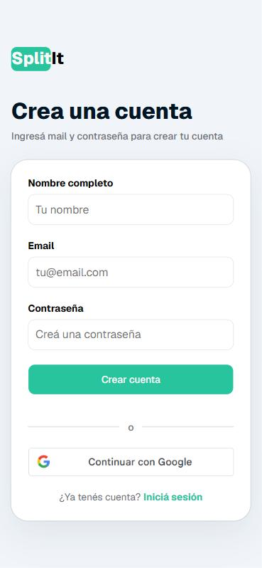

Si preferís no crear una contraseña, tocá **Continuar con Google** y elegí tu cuenta de Google.

## Iniciar sesión

**Con email y contraseña**

1. Entrá a [splitit.com.ar/login](https://splitit.com.ar/login). Si estás en la pantalla de inicio, tocá **Comenzar** y después **Iniciá sesión**.
2. Escribí tu email y tu contraseña. Con el ícono del ojo podés ver la contraseña mientras la escribís.
3. Tocá **Ingresar**.

   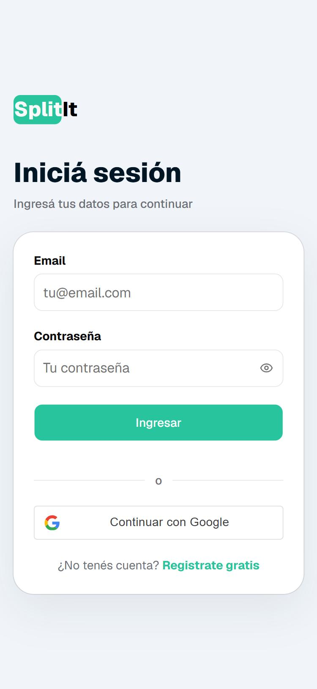

**Con Google**

1. En la misma pantalla, tocá **Continuar con Google**.
2. Elegí tu cuenta de Google y aceptá.
3. Si ya tenías una cuenta de SplitIt con ese mismo email, la app te pregunta qué hacer:
   - **Vincular**: seguís con tu cuenta de siempre, con tus eventos y gastos.
   - **Reemplazar**: se crea una cuenta nueva con los datos de Google y tus eventos pasan a esa cuenta.

   En los dos casos, de ahí en adelante entrás con Google y tu contraseña anterior deja de servir.

## Cerrar sesión

1. Tocá el botón de **menú** (arriba a la derecha) y elegí **Perfil**.

   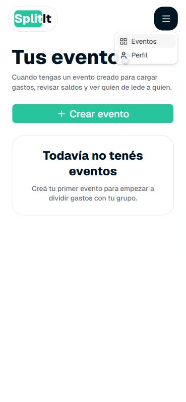

2. Abajo, en el recuadro **Sesión**, tocá **Cerrar sesión**.

   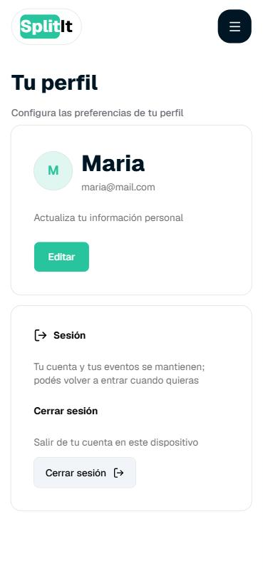

3. Volvés a la pantalla de inicio de sesión. Tu cuenta y tus eventos quedan guardados para la próxima vez.

   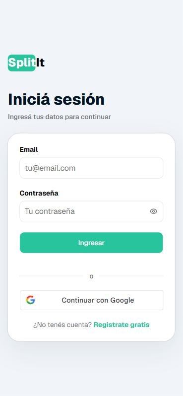

## Ver y editar mi cuenta

1. Tocá el botón de **menú** y elegí **Perfil**. Ahí ves tu nombre y tu email.
2. Tocá **Editar**.
3. Cambiá tu **nombre completo** o tu **email**.

   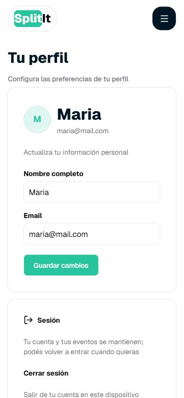

4. Tocá **Guardar cambios**. El perfil se actualiza al momento.

   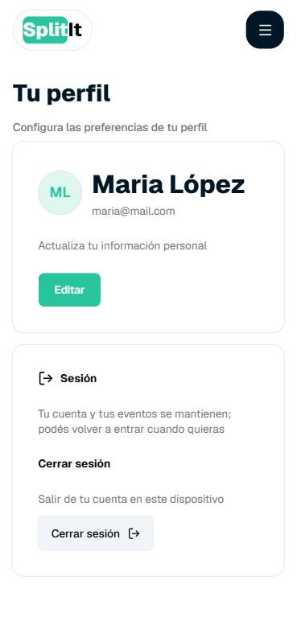

## Crear un evento

1. Tocá el botón de **menú** y elegí **Eventos**. Si todavía no tenés eventos, la lista aparece vacía.

   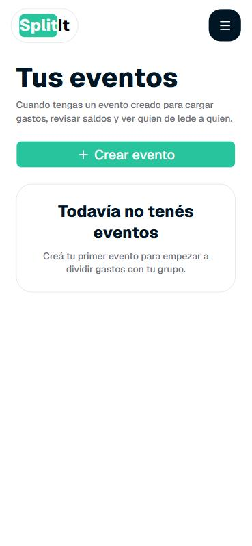

2. Tocá **Crear evento**.
3. Elegí un **ícono**: tocá el ícono de arriba y elegí uno de la lista.
4. Escribí el **nombre del evento** y, si querés, una **descripción** (por ejemplo, dónde y cuándo es).
5. Elegí la **moneda del evento**: en esa moneda se van a mostrar el total y los saldos. Después no se puede cambiar.
6. En **Integrantes**, escribí el nombre de cada persona y tocá **Agregar**. Vos ya estás en la lista. Con la **✕** sacás a alguien que agregaste por error.

   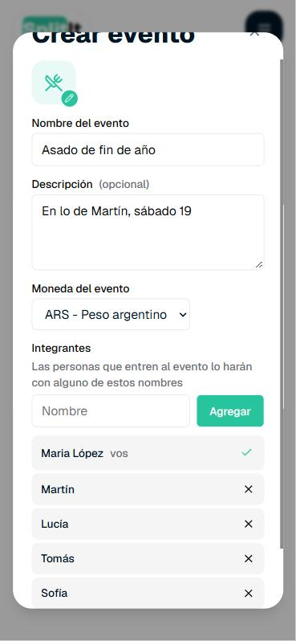

7. Tocá **Crear evento**. El evento aparece en tu lista.

   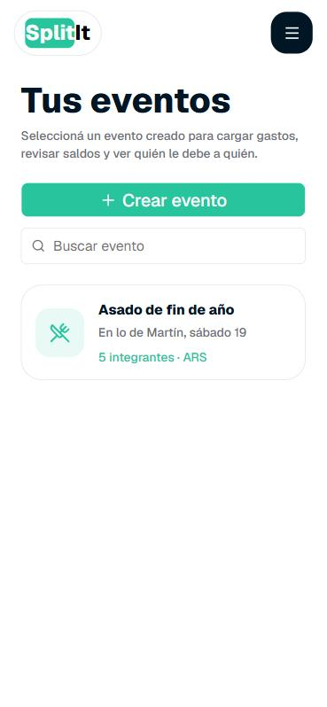

Tocá un evento para abrirlo. Arriba están los botones para **invitar**, **editar** y **eliminar**, y abajo las pestañas **Gastos**, **Saldos** e **Integrantes**.

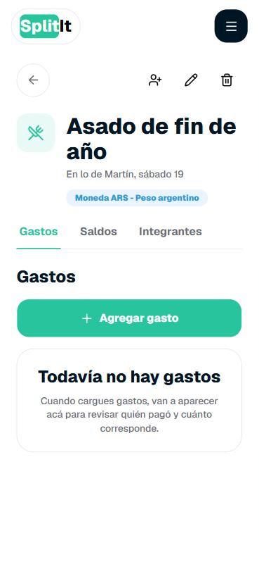

En la pestaña **Integrantes** ves quiénes participan. Los que todavía no entraron con su cuenta figuran como **Invitado**.

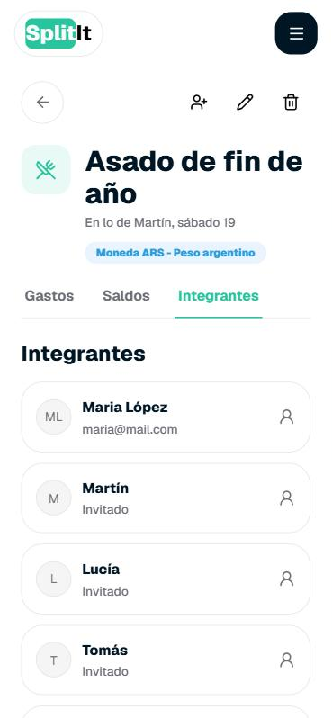

## Editar un evento

Solo quien creó el evento puede editarlo.

1. Abrí el evento y tocá el **lápiz** de arriba a la derecha.
2. Cambiá el ícono, el nombre o la descripción. La moneda del evento no se puede cambiar.

   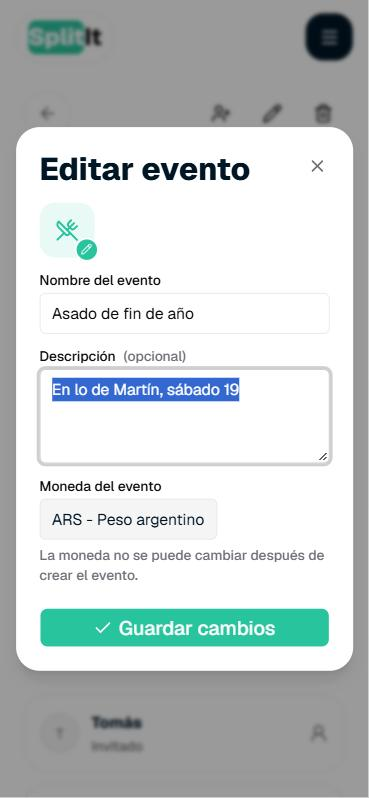

3. Tocá **Guardar cambios**.

## Eliminar un evento

Solo quien creó el evento puede eliminarlo, y solo si no tiene gastos.

1. Abrí el evento y tocá el **tacho de basura** de arriba a la derecha.
2. Leé el aviso: el evento desaparece para todos los integrantes y no se puede recuperar.
3. Tocá **Eliminar evento**.

   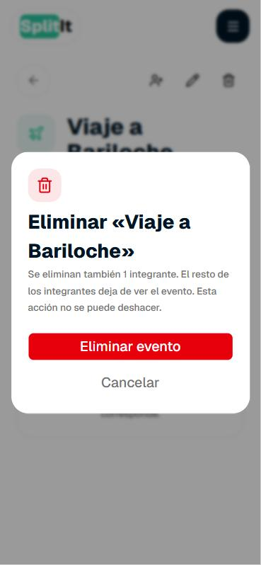

Si el evento todavía tiene gastos, la app te avisa cuántos son. Primero borrá esos gastos y después eliminá el evento.

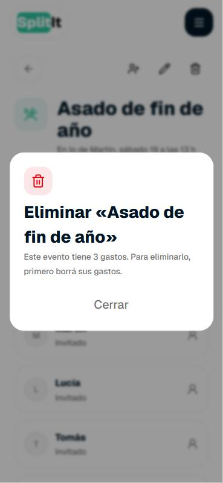

## Invitar a otros con el link

Solo quien creó el evento puede ver y compartir el link.

1. Abrí el evento y tocá el ícono de **persona con un +** de arriba a la derecha.
2. Tocá **Copiar enlace**.

   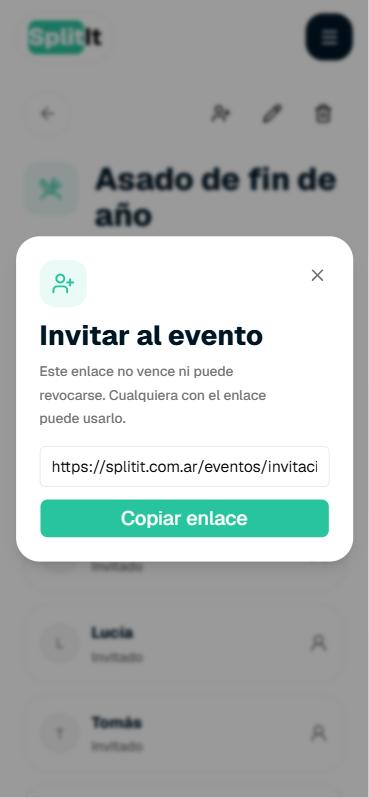

3. Pegá el link en el grupo de WhatsApp, en un mail o donde quieras.

El link no vence. Cualquier persona que lo tenga puede entrar al evento, así que compartilo solo con el grupo.

## Entrar a un evento con cuenta

Si tenés cuenta en SplitIt, entrar con ella hace que el evento te quede guardado en tu lista.

1. Abrí el link que te pasaron. Vas a ver el nombre del evento y cuántos participan.

   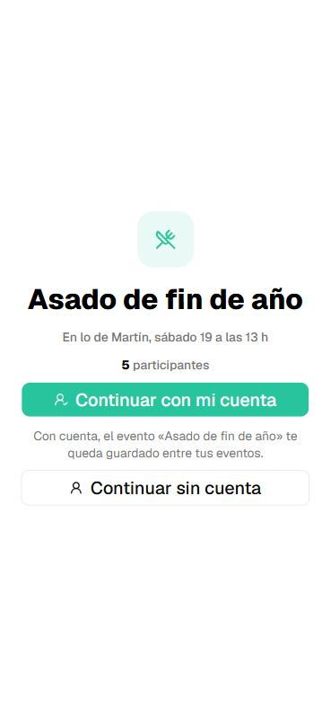

2. Tocá **Continuar con mi cuenta** e iniciá sesión (con email y contraseña o con Google). Si ya tenías la sesión iniciada, pasás directo al paso 3.
3. En **¿Quién sos en este evento?**, elegí tu nombre de la lista. Los integrantes que ya entraron con su cuenta aparecen marcados.
4. Tocá **Soy esta persona**. El evento se suma a tu lista de eventos y de ahí en adelante lo encontrás en **Eventos**.

Si ya formás parte del evento, la pantalla te lo dice y solo tenés que tocar **Entrar al evento**.

## Entrar a un evento sin cuenta

No hace falta tener cuenta para participar.

1. Abrí el link que te pasaron.
2. Tocá **Continuar sin cuenta**.
3. En **¿Quién sos en este evento?**, elegí tu nombre de la lista.

   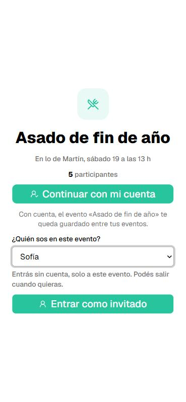

4. Tocá **Entrar como invitado**. Ya estás adentro: arriba aparece tu nombre y el botón **Salir**.

   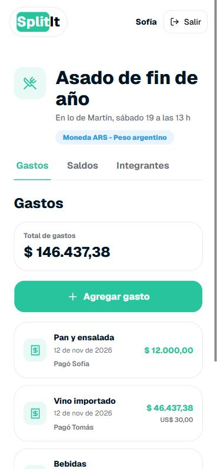

Para irte, tocá **Salir**. Para volver a entrar, abrí de nuevo el link.

## Cargar un gasto

1. Abrí el evento y, en la pestaña **Gastos**, tocá **Agregar gasto**.
2. Escribí el **nombre** del gasto (por ejemplo, "Carne y achuras") y el **monto**.
3. En **Pagó**, elegí quién lo pagó.

   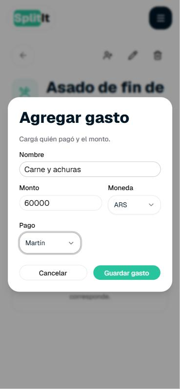

4. Tocá **Guardar gasto**. El gasto aparece en la lista y el **total de gastos** se actualiza.

   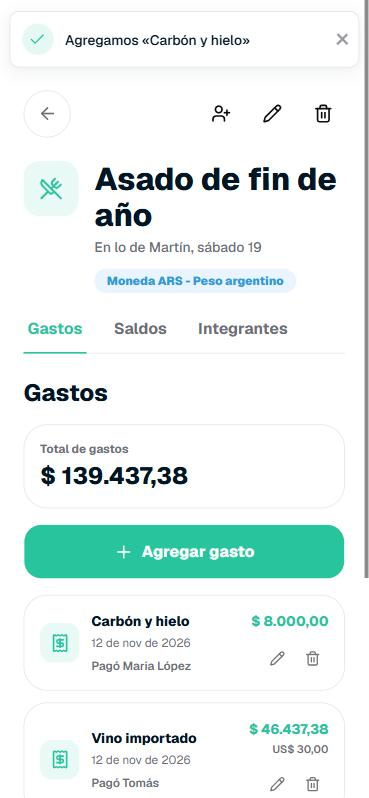

Cada gasto se reparte en partes iguales entre todos los integrantes del evento.

## Cargar un gasto en otra moneda

Sirve, por ejemplo, para algo que se pagó en dólares en un evento en pesos.

1. Tocá **Agregar gasto** y completá el nombre y el monto como siempre.
2. En **Moneda**, elegí la moneda en la que se pagó (por ejemplo, **USD**).
3. La app muestra la cotización del día y cuánto se va a guardar en la moneda del evento.

   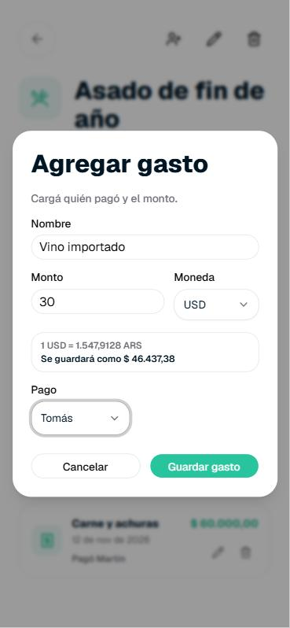

4. Elegí quién pagó y tocá **Guardar gasto**. En la lista se ve el monto convertido y, debajo, el monto original.

## Editar un gasto

1. En la lista de gastos, tocá el **lápiz** del gasto que querés cambiar.
2. Cambiá el nombre, el monto, la moneda o quién pagó.

   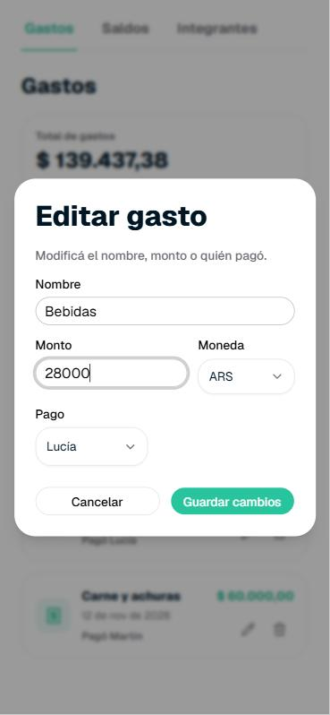

3. Tocá **Guardar cambios**. Los saldos se recalculan solos.

## Eliminar un gasto

1. En la lista de gastos, tocá el **tacho de basura** del gasto.
2. Confirmá con **Eliminar**. Los saldos se recalculan solos.

   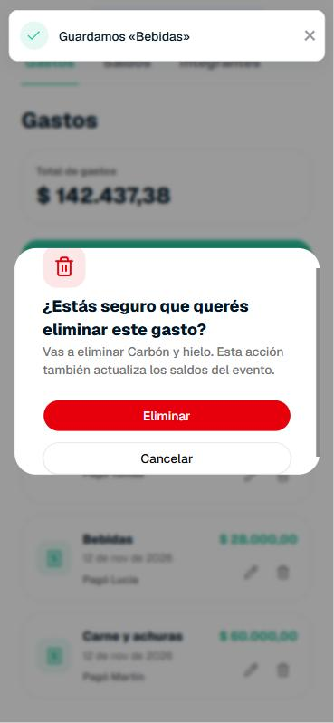

## Ver los saldos y los pagos sugeridos

1. Abrí el evento y tocá la pestaña **Saldos**.
2. En **Saldo por integrante** ves cómo queda cada uno:
   - **recibe** (en verde): pagó más de lo que le correspondía y le tienen que devolver.
   - **debe** (en rojo): pagó menos de lo que le correspondía.

   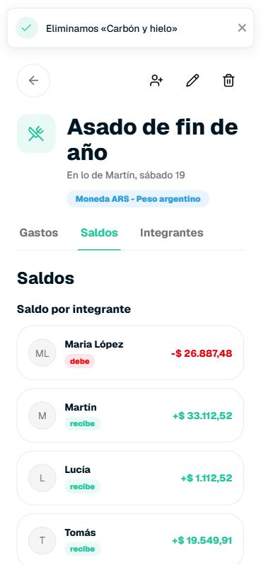

3. Más abajo, en **Pagos sugeridos**, está la lista de pagos para quedar a mano: quién le paga a quién y cuánto. Son los menos pagos posibles.

   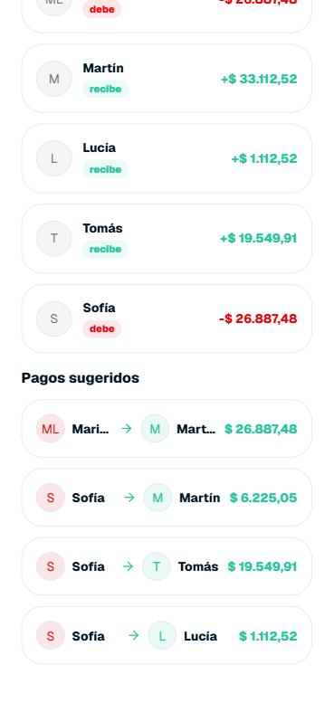

## Preguntas frecuentes

**¿Qué puede hacer alguien que entra sin cuenta?**
Puede ver los gastos, los saldos, los pagos sugeridos y los integrantes del evento, y cargar gastos nuevos. No puede editar ni eliminar gastos, ni invitar, editar o eliminar el evento. Además, solo ve el evento del link: no tiene una lista de eventos.

**¿Y alguien que entra con su cuenta?**
Puede hacer todo lo anterior y además editar y eliminar gastos. El evento le queda guardado en su lista. Invitar, editar y eliminar el evento lo puede hacer solo quien lo creó.

**¿Tienen que crearse una cuenta mis amigos?**
No. Con el link pueden entrar sin cuenta. Si se crean una cuenta, el evento les queda guardado y no dependen del link para volver.

**¿Cómo se reparte cada gasto?**
En partes iguales entre todos los integrantes del evento.

**¿Puedo cambiar la moneda de un evento?**
No. Se elige al crearlo. Lo que sí podés hacer es cargar cada gasto en otra moneda: la app lo convierte a la moneda del evento con la cotización del día.

**¿Por qué no puedo eliminar mi evento?**
Porque todavía tiene gastos. Borrá primero los gastos y después eliminá el evento. Si no lo creaste vos, tampoco ves el botón para eliminarlo.

**Se me escapó el link, ¿lo puedo anular?**
No. El link no vence y no se puede cambiar, así que compartilo solo con la gente del evento.

**Entré a la lista con el nombre equivocado, ¿qué hago?**
Si entraste sin cuenta, tocá **Salir**, abrí de nuevo el link y elegí tu nombre.

**¿Necesito bajar una app?**
No. SplitIt funciona desde el navegador del celular o de la computadora.
